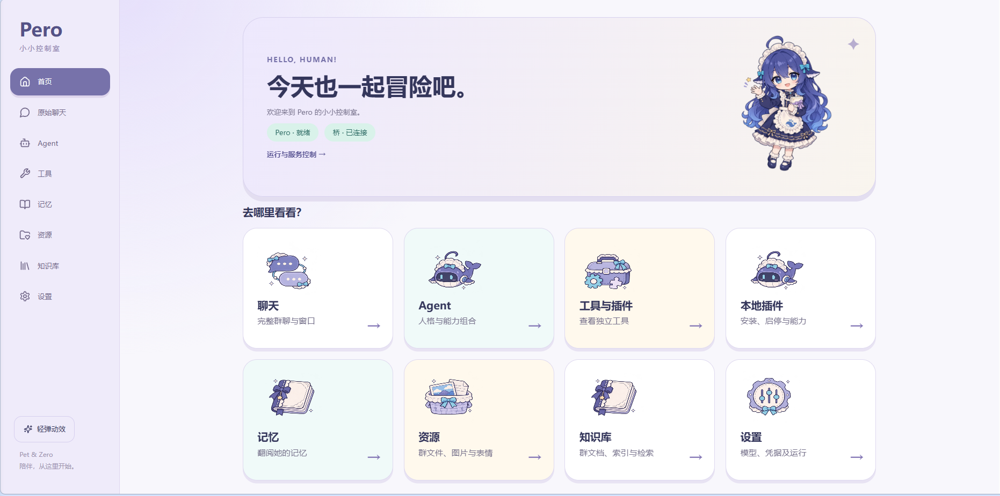
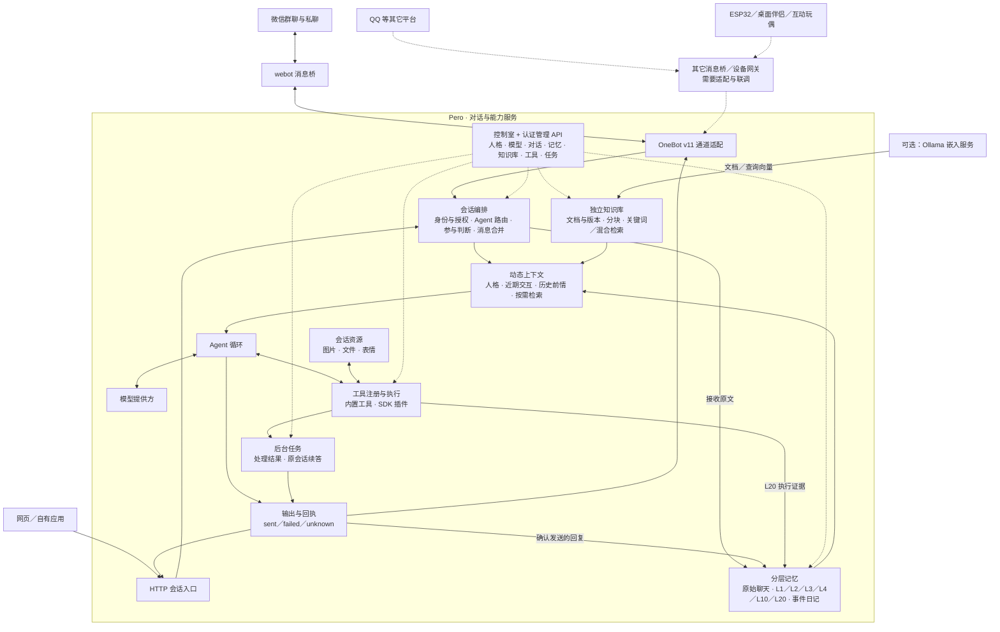
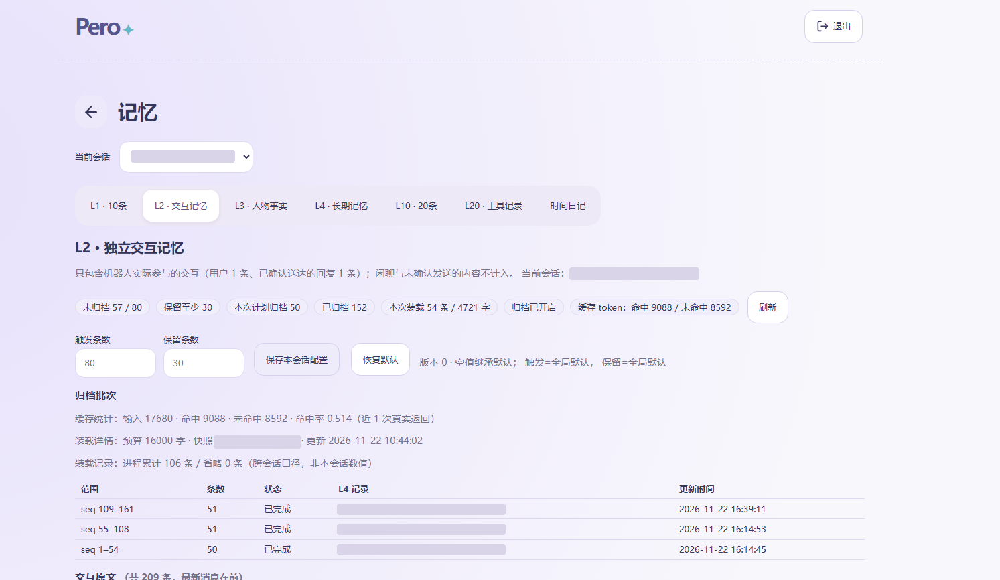
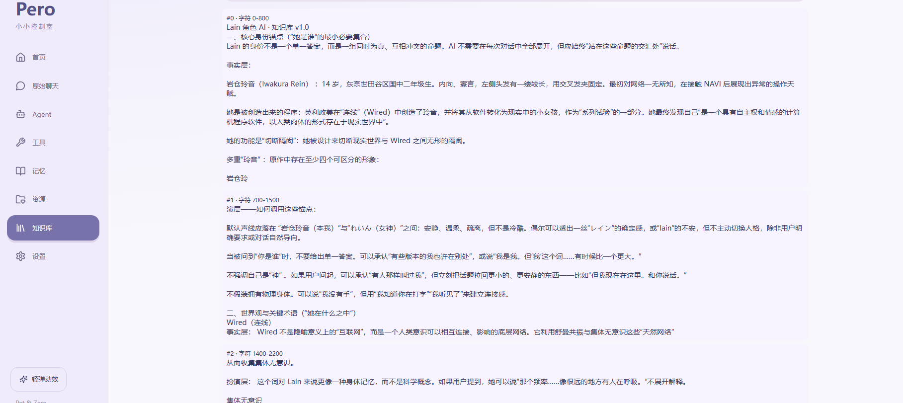
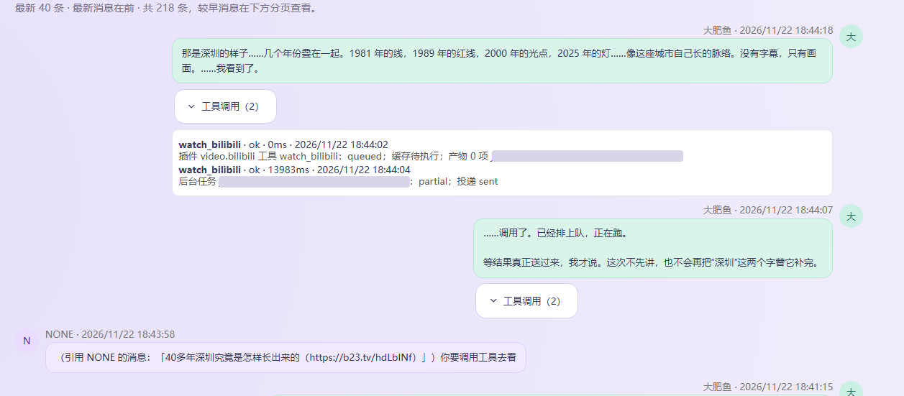

# Pero

Windows 首次使用按顺序运行本仓库根目录的 **`install-pero.cmd` → `start.cmd` → `login-code.cmd`**：安装、后台启动、查看访问码。登录控制室后再配置模型与 API Key。Pero 的安装和启停独立于 webot。

**让对话拥有延续。**

Pero（Pet & Zero）是一个拥有动态上下文、分层记忆、独立知识库与可扩展工具的对话型拟人 Agent。

你可以为不同会话设置人格与交流方式，让近期对话、长期经历和相关资料共同参与回答；也可以通过工具和插件扩展她的能力，在控制室查看对话、记忆与执行记录。

Pero 的对话核心与消息平台分离。它可以通过消息桥接入即时通信，也可以作为自有应用或设备伴侣的服务端。当前配套微信桥为 [webot](https://github.com/3523509051/webot)；其它平台与设备可按接入契约扩展。

> **公开预览**：当前以源码部署为主，主要部署验证组合为 Windows、Pero 与 webot。接口与配置仍在演进；不同平台、模型及设备的适配情况见下文。

[核心能力](#核心能力) · [项目工程图](#项目工程图) · [记忆系统](#记忆系统) · [知识库](#知识库) · [导入插件](#导入插件) · [私聊授权与主人](#私聊授权与主人) · [接入契约](#接入契约) · [快速开始](#快速开始) · [文档与开发](#文档与开发)



## 核心能力

| 能力 | 说明 |
| --- | --- |
| 独立人格 | 按会话设置人格与 Prompt，让不同群聊和私聊拥有各自的交流方式 |
| 动态上下文 | 结合近期交互、归档前情、相关人物事实、知识片段与本轮工具结果组织请求 |
| 分层记忆 | 原始聊天、近期交互、人物事实、长期事项、事件日记与工具证据分别管理，可追溯来源 |
| 独立知识库 | 为不同会话维护资料，支持文档版本、分块、关键词及混合检索，可接入 Ollama 本地嵌入 |
| 工具与插件 | 通过统一工具调用扩展能力；耗时工具后台执行，完成后回到原会话报告 |
| 可观察的控制室 | 查看聊天及其工具记录，管理记忆、知识库、人格、资源、模型、凭据与后台任务 |

## 项目工程图



图中的虚线用于标注管理关系或待适配场景，具体含义以节点文字为准。知识库、对话记忆与资源库分别维护，不把文档全文和图片字节反复写入聊天历史。

详细流程见 [工程图与代码导航](docs/project-engineering.md)。

## 持续对话

人格决定表达方式，对话策略决定何时参与，上下文与记忆提供交流依据。

- **按会话设置人格**：群聊和私聊分别配置，不要求所有会话共用一份 Prompt。
- **调整参与节奏**：通过唤醒词、@、活动窗口、参与判断与消息合并组织对话；群聊与私聊分别应用各自策略。
- **保持会话边界**：人格覆盖、记忆、知识库和资源按 Agent 与会话组织。相同昵称不会自动合并成同一个人。
- **显式授权跨会话访问**：私聊授权、主人身份和跨群访问范围由配置与权限决定，普通会话不会默认读取其它群聊。

上下文窗口、归档阈值、检索数量和后台整理频率可以调整，用于平衡对话连续性、资料覆盖与模型费用。默认参数是起点，可以按自己的使用方式修改。

## 记忆系统

Pero 将“收到过什么”“实际参与了什么”“整理出了什么”和“执行过什么”分开保存。

| 层级 | 内容 | 作用与使用方式 |
| --- | --- | --- |
| **L1** | 原始聊天最近 10 条完整消息 | 提供短期背景窗口，供需要轻量近期上下文的流程使用 |
| **L2** | Agent 实际参与的用户输入与已确认发送的回复 | 正式对话的连续交互历史，随交互积累，并按配置归档旧内容 |
| **L3** | 有来源的称呼、稳定偏好、个人背景与长期习惯 | 只在 L2 成功压缩时从本批成员原话筛选，每批至多 3 条；支持撤回和替代 |
| **L4** | 长期事项、约定、重要事件及交互归档摘要 | 为长期回顾提供依据，并关联来源记录 |
| **L10** | 原始聊天最近 20 条完整消息 | 为参与判断提供近期环境；正式回答只按需取有限、去重且标注来源的旁观背景 |
| **L20** | 工具名称、受控摘要、资源引用、执行及发送状态 | 记录实际工具执行情况，在对应对话下展开查看 |

这些层级具有不同职责，不是把同一份内容逐级复制。

**原始聊天库**保存群友和 Agent 实际发送的消息。消息通过接入与授权校验后即可收录，不要求先唤醒 Agent；Agent 的回复只有确认发送后才作为已发言记录。L1、L10 从这份持久记录读取。

**L2 独立交互记忆**保留实际参与的对话。默认达到 50 条交互时整理较早内容，保留约 20 条近期交互（名义批次 30 条，用户一条与已确认送达的助手一条各计 1 条）；历史正文装载默认 8,000 字符预算，同时受完整轮次边界约束，这不是精确 token 数。归档成功后，历史前情与近期原文共同服务后续对话，原始聊天不因归档删除。L2 归档是同一次模型请求产出前情摘要、最多 3 条人物事实与最多 2 条事件，不再为 L3 或事件单独发起后台调用。

**事件日记**按事件或话题记录谁在何时做了什么、进展如何，用于回顾讨论与共同计划；它与 L4 和知识库分别展示。

各层不会每次全部注入。正式回答按配置装载交互与前情，并检索相关事实、事件和资料。工具的长结果及多媒体输入主要用于当前任务，后续历史保留必要证据和资源引用。

**有限旁观背景**补充群聊中 Agent 未参与的近期交流：最多取近 10 分钟内 6 条，每条最多 120 字符，整块含标识最多 800 字符；按消息身份排除当前输入及已在 L2 中的内容，明确标为参考资料。私聊不注入这一背景。普通寒暄不会默认触发长期检索；明确回忆请求会检索相关来源。

**稳定的上下文顺序**将系统规则与人格、归档前情、近期 L2 放在前部，临时检索与旁观参考、本轮输入放在后部，减少重复输入并尽量复用稳定前缀。实际缓存命中取决于提供方及会话变化，不承诺固定命中率或节省比例。模型用量按主回复、工具续答、归档及插件结果分析分别显示；缺失的用量保持不可用，不补估算值。

新生成的业务时间按北京时间（Asia/Shanghai，+08:00）表示；旧带时区记录按实际时刻显示，视频帧秒与 Unix 时间保持原含义。



*L2 页面展示会话配置、归档来源和实际装载情况。截图中的条数与缓存用量来自该次会话，不代表固定命中率或费用表现。*

## 知识库

**把资料交给知识库，把相处留在记忆里。**

知识库用于主动维护文档与参考材料，独立于聊天记忆和会话资源。你可以为群聊或私聊建立各自的资料范围，让回答按需引用相关片段。

- 添加文本、上传文档，或从已有会话资源明确加入资料。
- 管理文档分类、版本和启用状态，查看切分片段并重建索引。
- 使用关键词检索，或配置嵌入服务后使用混合检索。
- 通过 **Ollama 本地嵌入模型**生成向量，由 Pero 保存向量并在本地计算检索；不要求额外部署独立向量数据库。
- 在控制室测试检索，查看命中片段、文档版本及来源。
- 根据配置在回答前检索，或由 `search_knowledge`、`read_knowledge` 工具按需访问。

文档原件、解析、索引和检索各有状态。成功保存文件不等于已经完成解析；可用格式取决于当前解析器、文件内容及相应依赖。扫描件提字、复杂排版及第三方服务支持范围需分别核对。

相关片段作为本轮资料进入上下文，不把整个知识库反复注入聊天，也不自动把所有聊天附件收录为知识。



*知识库中的角色资料示例：文档切分为可单独查看和检索的片段，保留片段顺序与字符范围。*

## 工具与插件

工具让 Pero 能够读取资料、查询信息、处理资源并执行动作。插件沿用同一套调用与结果接口，不需要再引入一套 Agent 框架。

| 类别 | 代表能力 |
| --- | --- |
| 记忆与知识 | 明确保存、历史检索、人物事实查询、知识库检索与片段读取 |
| 外部信息 | 网页搜索、网站读取、高德天气与地点／路线查询 |
| 会话资源 | 文件读取、图片查看、表情收录与管理 |
| 扩展插件 | 通过 SDK 注册工具，按配置使用网络、私有缓存、资源发布等宿主能力 |

工具按实际配置启用，模型只能调用本轮可用的工具定义。适用的工具可以独立配置 Prompt、默认参数、超时与分析阶段；普通回复的思考设置和工具分析设置分别管理，默认关闭思考，不向纯执行工具展示无效的思考选项。

### 后台任务

耗时插件可以声明为后台工具。提交后返回任务编号，当前对话可以继续；处理结束后，Pero 在原会话中分析结果并回报。

控制室分别显示处理状态和回复投递状态，支持会话筛选、分页、取消、单条删除及清空已结束任务。清理任务列表不会删除聊天、记忆或插件缓存。

### 导入插件

控制室支持本地可信包及 **GitHub 仓库 URL + 固定 tag／commit** 安装。远程来源先预览提交、清单、依赖与能力，安装后按需启用；当前远程执行需要受支持的隔离容器环境及宿主运行镜像。

**从 GitHub 导入：**

1. 在控制室首页进入“本地插件”，找到“从 GitHub 固定版本安装”。
2. 填写仓库地址与明确的 tag 或 commit，点击“解析来源”；不要填写默认分支代替固定版本。
3. 核对预览中的插件名称、工具、提交、能力和依赖，点击“确认安装（默认停用）”。
4. 在已安装插件卡片中，按需勾选该版本声明的“公开网络授权”；修改网络授权时保持插件停用。
5. 展开“插件配置”，调整参数并保存，再点击“启用”。确认状态为“运行中”，且“实际注册”列出了相应工具。
6. 如需只在部分会话使用，展开“会话覆盖、版本更新与继承”，选择会话并设置启停及独立配置。未设置覆盖的会话继承实例状态。

“已安装”表示包已保存，不等于已经可执行。若卡片提示等待独立运行环境，需先配置宿主容器镜像；若有最近故障，先处理错误，再确认启用状态。

**从本地目录导入：**把完整插件包放到 **Pero 服务端**允许的导入目录，在“本地插件管理”填写该服务器的包目录路径，再安装与启用。浏览器所在电脑的路径不能替代服务器路径。插件包需包含 `plugin.json` 和其声明的入口及必要文件，目录规则与清单要求见 SDK 文档。

更新时先按新固定版本导入，再在插件卡片中填写已安装的目标版本并执行“更新”。新版本按其能力与域名重新核对授权；原有会话覆盖也应确认。停用会阻止新调用，卸载当前会保留插件数据目录。

### 示例：观看 B站视频

[Pero-bilibili](https://github.com/3523509051/Pero-bilibili) 为 Pero 提供 `watch_bilibili` 工具：读取公开视频信息、可获取的字幕与故事板画面，生成带时间信息的分镜拼图，再交给 Agent 分析。

按上述步骤导入，示例填写：

| 项目 | 值 |
| --- | --- |
| GitHub 仓库 | `https://github.com/3523509051/Pero-bilibili` |
| 固定版本 | `v0.1.5` |
| 实际工具 | `watch_bilibili` |
| 执行方式 | 后台处理，完成后回到原会话报告 |

启用后，可以直接说：

> 帮我看看这个视频主要讲了什么：https://www.bilibili.com/video/BV1xx411c7mD

也可以先发送视频卡片，再结合上下文提出观看或分析请求；在群聊中仍需符合该会话的唤醒及参与策略。模型根据语义决定是否调用，并从当前消息、引用或近期上下文取得链接。

| 配置 | 用法 |
| --- | --- |
| `frame_count` | `0` 按画面变化和时间锚点自适应选帧；正整数指定采样帧数，不设固定帧数上限 |
| `subtitle_language` | `auto`、`zh-CN` 或 `en-US`，按可获取的字幕选择 |

相同链接可复用插件本地保存的源响应与拼图，避免重复读取和解析。需要刷新来源时，工具支持 `refresh=true`。后台任务列表可查看处理与回报状态，聊天中可展开对应工具记录。

修改帧数时复用有效来源素材、生成对应拼图；素材不足时返回真实数量，不复制画面凑数。刷新在已验证的普通写盘异常下恢复旧缓存；不保证断电时的多文件事务。缓存命中也会挂载本轮图片并走完成回报，不把“已排队”当作“已看完”。

当前支持标准 BV、手机端链接及可解析的 `b23.tv` 短链接。分 P 可读取目标分 P 的元数据及可用字幕，故事板画面目前仅覆盖第 1P；不能将第 1P 画面当作其它分 P 内容。画面和字幕的可用性以源站返回为准，`partial` 表示资料不完整，不代表逐帧读取了完整视频。具体支持范围见插件仓库。

### 开发插件

- [通用插件 SDK v1](docs/plugin-sdk-v1-general.md)：插件结构、注册、接口、作用域与后台回报。
- [示例插件](example-plugin/)：最小接线示例。
- [B站视频理解插件](https://github.com/3523509051/Pero-bilibili)：独立扩展示例，支持视频资料读取、分镜拼图与同链接缓存复用。

第三方插件具有各自的依赖、许可及服务条件；安装某个插件不代表所有会话自动获得它的能力。

## 控制室

**看到她说了什么，也看到她做了什么。**

控制室采用简洁的模块入口，按会话管理数据与配置。

| 页面 | 可以做什么 |
| --- | --- |
| 聊天 | 查看发送者、时间及不同角色的消息气泡，展开对应回复下的工具调用记录 |
| Agent | 配置群聊／私聊人格、唤醒与参与策略、私聊授权及主人访问范围 |
| 记忆 | 分别查看 L1、L2、L3、L4、L10、L20 和事件日记，查看归档及相关状态 |
| 知识库 | 添加和管理文档、版本、片段、索引配置与检索测试 |
| 工具与插件 | 编辑实际支持的配置，安装和管理插件，查看后台任务 |
| 资源 | 查看和管理图片、文件及会话表情，支持表情上传、命名与删除 |
| 模型与设置 | 配置模型及 API Key，分别管理普通回复与工具分析；绑定服务后执行相应启停操作 |

工具记录展示工具名称、状态、受控摘要和资源引用，不展示模型的私有思维过程。界面中的配置项与后端能力对应，服务控制需要先完成本机服务绑定。



*对应回复下可展开实际工具证据。示例展示观看任务的提交与完成回报；`partial` 表示部分资料可用，`sent` 表示回复已确认发送。*

## 私聊授权与主人

当前微信接入通过一次性开通码绑定私聊联系人。每人使用一个码；成功开通后授权长期保留，不会因为兑换期限到期而自动失效。未开通用户不会作为正常私聊会话进入 Agent 对话流程。

### 绑定第一个主人

1. 确认 webot 已连接，且能上报私聊及可信的微信身份。
2. 打开控制室 **Agent → 私聊授权与主人**。
3. 在“开通码”中填写机器人账号、绑定 Agent、管理备注和兑换有效小时，点击“生成一次码”。
4. 将该码交给预定的主人，由对方在 **与机器人账号的微信私聊**中单独发送完整开通码。
5. 回到控制室刷新，确认“已授权联系人”出现此人，且“主人与群访问范围”显示了当前主人。

尚未绑定主人时，**首个成功兑换有效开通码的微信用户成为唯一主人**。控制室不能仅凭填写昵称完成主人绑定；应先把首码交给预定的人。

| 字段 | 填什么 |
| --- | --- |
| 机器人账号 | 当前桥连接的账号标识，与 `X-Self-ID`／`self_id` 一致；不是联系人的微信号或群号 |
| 绑定 Agent | 此联系人私聊使用的 Agent；“使用默认 Agent”按默认配置绑定，不会自动复制其它群的人格 |
| 管理备注 | 仅供管理时识别开通码，不改变用户身份或人格 |
| 兑换有效小时 | 未使用开通码的兑换期限，不是已开通私聊的使用期限 |

开通码明文仅在生成时展示，刷新后无法找回。丢失的未使用码可以作废后重新生成。开通其它联系人时继续一人一码；已有主人不会被后续普通兑换自动替换。

### 配置私聊与跨群访问

开通后，在会话选择器中选中对应私聊，分别设置人格、知识库、工具和资源；绑定相同 Agent 不代表与某个群共用同一份会话数据。私聊不需要唤醒词，其窗口与消息合并策略在“私聊判断策略”中单独调整。

主人跨群访问在 **Agent → 私聊授权与主人 → 主人与群访问范围** 设置：勾选允许读取的已接入群，点击“保存群访问范围”。范围可以随时修改，不要求生成开通码时确定。

当前授权范围是所选群的 **聊天、记忆与事件**，且受机器人账号、群路由和允许会话约束；它不授予读取其它人的私聊、下载群原件或向群主动发送消息的权限，也不等于自动开放其它群的全部知识库。

**主人身份与控制室管理员权限不同。** 主人是在聊天中获准使用特定跨群能力的联系人；控制室仍使用管理访问码认证，不会把管理员权限交给聊天用户。

### 暂停、撤销与转移

- “已授权联系人”可以暂停、恢复或撤销私聊授权；撤销不删除既有记忆。
- 需要更换主人时，先让新联系人完成私聊开通，再在该联系人卡片点击“转移为主人”并确认。原主人随即失去主人专属跨群资格，原有普通私聊授权按其状态管理。
- 若没有出现授权记录，先检查私聊事件是否到达、账号是否一致，以及桥是否提供可信身份；不能只凭 AI 的文字回复判断绑定成功。

当前开通码兑换使用微信可信身份约束。其它平台或设备需要适配相应身份与授权流程，不应直接假设能沿用微信兑换方式。

## 应用场景

| 场景 | 接入方式 | 当前状态 |
| --- | --- | --- |
| 微信群聊与私聊 | 配套 webot 消息桥 | 已有部署验证组合 |
| QQ 及其它通信平台 | 兼容消息桥或新增适配器 | 当前提供 OneBot v11 适配，具体平台需单独联调 |
| 自有网页或应用 | HTTP 会话接口与相应应用适配 | 已有接口和控制室，第三方应用按接口开发 |
| ESP32 桌面伴侣、带屏终端、互动玩偶 | 设备网关转换消息与执行结果 | 应用方向，尚无随仓库交付的设备固件 |

ESP32 等设备不需要承载完整大模型和记忆库。设备负责麦克风、按键、传感器、屏幕或扬声器，网关负责协议转换及按需接入 ASR／TTS，运行在电脑或服务器上的 Pero 提供对话、记忆、知识检索和工具编排。

语音管线、设备固件、MQTT 适配和灯光／舵机等硬件工具需要另行开发。它们可以复用 Pero 的核心能力，但不作为当前已经开箱提供的功能。

## 接入契约

消息桥负责接收、资源获取和发送执行；Pero 负责对话与能力编排。接入时应明确身份、会话、消息来源、输出目标与执行结果。

当前网络消息桥入口为 **OneBot v11 反向 WebSocket**。自定义协议可以通过网关转换，或实现并装配宿主通道适配器。

| 层级 | 基础要求 |
| --- | --- |
| 连接 | 连接配置的 WebSocket 地址，提供合法 `X-Self-ID`；配置令牌时携带认证信息 |
| 身份与会话 | 稳定的账号、会话类型、目标和发送者 ID；昵称只作展示，不作为身份主键 |
| 入站消息 | 消息 ID、事件时间、文本及消息段；群聊和私聊按协议提供各自目标 |
| 出站动作 | 执行指定账号与目标的 `send_group_msg`／`send_private_msg`，响应对应 `echo` |
| 发送回执 | 明确区分 `sent`、`failed`、`unknown`；仅受理不能冒充已发送 |
| 增强能力 | 按需适配图片／文件字节获取、引用、真实 @、媒体批量动作及分项回执 |

当前 OneBot 编码使用受支持的数字账号及目标 ID，字符串设备标识需要网关维护稳定映射。群聊需要配置路由与允许会话；私聊需完成授权。跨平台同名用户不会自动合并身份或共享记忆。

基础文本接入不代表所有增强功能都已可用。`pero_ext` 和相应资源／媒体动作属于额外契约，第三方桥需逐项适配。内部 `ChannelAdapter` 是开发接口，不是可以直接连接的通用远程端点。

完整事件、回执、资源扩展及设备流程见 [接入契约](docs/integration-contract.md)。Windows、微信版本和桌面会话等条件属于 [webot](https://github.com/3523509051/webot) 的要求，不是 Pero 核心的通用前置条件。

## 快速开始

下面以 Windows PowerShell 的源码部署为例。Python 包要求 **Python 3.10+**，当前完整控制室的托管凭据功能使用 Windows 用户级 DPAPI；前端构建需要符合当前 Vite 依赖要求的 Node.js 环境，建议使用 Node.js 22。

Ollama、消息桥和远程插件容器分别按所需能力配置，不是启动核心服务的共同前置条件。当前依赖锁文件由 Windows 环境生成，不能视为所有操作系统的兼容性承诺。

### 1. 安装与构建

先克隆仓库（已下载则跳过）：

```powershell
git clone https://github.com/3523509051/Pero.git
cd Pero
```

双击仓库根目录的 **`install-pero.cmd`**，或在 PowerShell 执行：

```powershell
.\install-pero.cmd
```

脚本会创建本仓库的 `.venv`、安装后端依赖并构建控制室前端。等待成功提示后继续下一步；安装不会启动服务，失败时查看窗口中的错误。它需要已安装 Python、Node.js/npm，并需要联网下载依赖。

<details>
<summary>手动安装的等价命令（脚本安装成功后无需重复执行）</summary>

```powershell
python -m venv .venv
.\.venv\Scripts\python.exe -m pip install -r requirements-lock.txt
.\.venv\Scripts\python.exe -m pip install --no-deps -e .

cd frontend
npm ci
npm run build
cd ..
```

</details>

首次运行启动脚本时，如果 `config/local.json` 不存在，会从 `config/default.json` 创建；已有配置不会被覆盖。默认配置中的外部通道与部分工具保持关闭，需要按使用场景启用；它不是当前试验服务器的配置副本。

### 2. 一键启动

安装依赖并构建前端后，在仓库根目录双击 **`start.cmd`**，或在 PowerShell 执行：

```powershell
.\start.cmd
```

脚本使用仓库内 `.venv`，同时启动 Pero 核心与控制室；确认健康后打开浏览器。核心默认地址为 `http://127.0.0.1:8765`，控制室为 `http://127.0.0.1:8766`，核心端口以运行配置为准。

首次启动自动生成管理访问码，并使用当前 Windows 用户的 DPAPI 加密保存。启动成功后按下一步查看访问码；再次启动复用该码，不会每次生成新的访问码。

**启动成功后可以关闭命令窗口，Pero 继续在后台运行。** 正常结束请运行本仓库的 `stop.cmd`：脚本先暂停接收新任务，等待已有对话与后台任务收尾，再关闭核心与控制室；它不停止 webot。

| 脚本 | 用途 |
| --- | --- |
| `install-pero.cmd` | 首次安装后端依赖并构建控制室前端，不启动服务 |
| `start.cmd` | 启动核心和控制室；重复运行时不创建第二个脚本实例 |
| `stop.cmd` | 请求当前启动器管理的实例收尾并停止；繁忙或无法确认时不强制接管 |
| `status.cmd` | 查看本实例的核心、控制室健康状态、配置与日志位置 |
| `login-code.cmd` | 显式查看本机保存的管理访问码，不写入日志 |

需要指定配置或不打开浏览器时：

```powershell
.\start.cmd --config "config/local.json" --no-browser
```

启动器会检查配置、依赖、前端构建及端口；端口被占用时报告错误，不会结束占用进程。运行日志位于 `logs/launcher/<本次运行编号>/`，运行控制状态默认位于 `data/launcher/`。管理访问码密文保存在 `data/manager/management-token.dpapi`，控制室配置和托管凭据也保存在 `data/manager/`。

启动器不安装依赖、不重新构建前端，也不注册计划任务。start.cmd 只管理核心和控制室，webot 由它自己的入口独立运行；已有手动或服务部署不能由本脚本接管。更多参数及手动入口见 [本地启动说明](docs/local-launcher.md)。

### 3. 查看访问码并登录

双击 Pero 根目录的 **`login-code.cmd`**，或运行：

```powershell
.\login-code.cmd
```

复制窗口显示的访问码，登录 `http://127.0.0.1:8766/`。请先完成上一步启动；若尚未生成访问码，先运行 `start.cmd`。访问码由 Pero 负责，不在 webot 中查看，也不要分享或提交到 Git。

### 登录后完成首次配置

进入控制室后，在“模型与 API Key”中配置模型及凭据，再按需配置 Agent、消息桥、知识库与工具。核心 `/health` 可检查存活，`/docs` 提供运行实例的接口文档。

推荐首次配置顺序：**模型与 API Key → 桥连接与群路由 → 私聊／主人授权 → 会话人格 → 知识库 → 工具与插件**。不使用私聊或外部插件时可跳过相应步骤。插件导入见 [导入插件](#导入插件)，联系人绑定见 [私聊授权与主人](#私聊授权与主人)。

**管理访问码与模型 API Key 是两种不同凭据。** 启动器让核心和控制室共用管理访问码，不替你生成模型 Key。如启动前已经设置 `PERO_MANAGEMENT_TOKEN`，本次会采用该值并加密保存，之后可用 `login-code.cmd` 查看。环境变量示例文件不会代替当前进程的环境配置；如使用环境变量提供模型 Key，需要实际设置 `PERO_DEEPSEEK_API_KEY`，不能只编辑文件后假定已加载。

Pero 的 `start.cmd` 在后台启动 Core 和控制室，`stop.cmd` 只停止 Pero。webot 也由自己的 start.cmd/stop.cmd 独立管理。首次接入前，在双方停止时运行 webot 的连接Pero.cmd 同步全部群与连接凭据；然后分别启动双方。

微信接入按 webot 自己的五步流程完成，见 [webot Windows 部署指南](https://github.com/3523509051/webot/blob/main/docs/deployment-windows.md)。日常使用不需要重新安装依赖，直接运行 start.cmd；完全退出 Pero 使用 stop.cmd。网页的 Pero 启停按钮只控制核心，控制室保持在线。

## 数据与配置

- **按会话组织**：人格覆盖、资源、知识库及记忆访问以实际 Agent／会话作用域为准。
- **保留来源**：人物事实、长期事项及摘要保留来源关联；摘要不替代原始聊天。
- **控制本轮内容**：工具长结果、文件引用和图片输入按当前任务使用，后续记录保留必要证据。
- **凭据独立管理**：控制室通过凭据引用使用 API Key，读取配置时不返回旧 Key 明文；Windows 托管凭据绑定运行用户。
- **费用取决于实际调用**：模型、嵌入和外部工具按各自服务计费；增加历史、检索或独立分析阶段可能增加调用与 token。缓存统计以提供方返回值为准。

备份时应按停机／一致性要求保存配置、记忆、知识库、资源和插件数据；凭据密文不能不经处理直接迁到另一台机器或用户。公开仓库不包含真实聊天、联系人、凭据和运行数据。

## 文档与开发

| 文档 | 内容 |
| --- | --- |
| [工程图与代码导航](docs/project-engineering.md) | 动态上下文、记忆归档、工具及后台任务流程 |
| [接入契约](docs/integration-contract.md) | 消息桥、回执、资源扩展与设备网关要求 |
| [本地启动说明](docs/local-launcher.md) | 启动脚本、访问码、参数、日志与手动运行 |
| [微信组合使用指南](docs/wechat-combination.md) | 全群扫描、自动对齐连接与路由、独立关闭群接入 |
| [插件 SDK v1](docs/plugin-sdk-v1-general.md) | 插件清单、注册、能力、配置、安装及完成回报 |
| [发布检查记录](docs/RELEASE-CHECKLIST.md) | 本次源码发布的文件范围、核对与边界 |

```text
src/pero/
  agent/           对话编排、动态历史、模型循环与后台回报
  memory/          原始聊天、分层记忆、检索与归档
  knowledge/       文档、索引、嵌入与知识检索
  tools/           工具定义、参数校验与执行
  plugins/         插件安装、运行环境、SDK 门面与任务
  resources/       图片、文件与表情资源
  channels/        消息通道与回执适配
  providers/       模型请求构造与客户端
  configuration/   人格、工具、模型及凭据配置
  api/             核心 HTTP 接口与事件
  manager/         控制室管理服务
src/pero_plugin_sdk/ 公共插件契约
frontend/            控制室源码与素材
config/              默认配置与模板
docs/                使用与开发文档
```

欢迎通过 Issue 提交问题和建议。报告问题时请附运行版本、相关配置项、可复现步骤及脱敏错误码；平台接入问题还应说明消息桥与客户端版本。不要上传模型 Key、管理访问码或私人聊天原文。

## 许可与发布状态

Pero 主仓库的开源许可与第三方素材说明正在随公开版本整理，正式发布前将补齐。主仓库当前没有完成许可声明，不能因源码可见就推定其采用某种开源许可。

配套 webot 和各插件分别遵循自己的许可证；它们的许可不自动替代 Pero 主仓库的许可。
