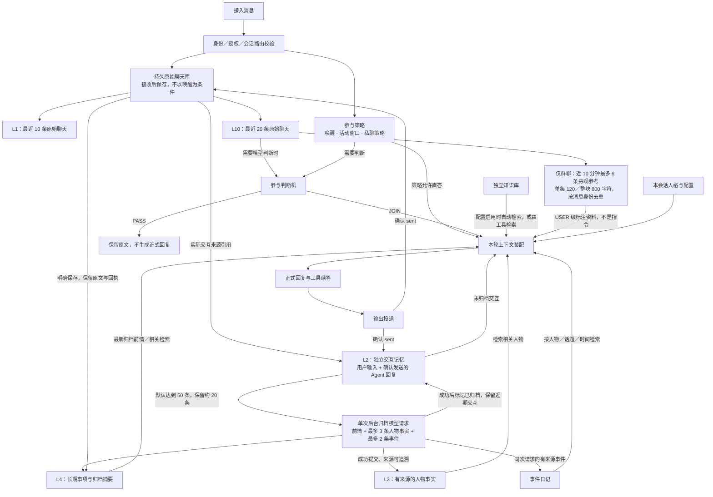
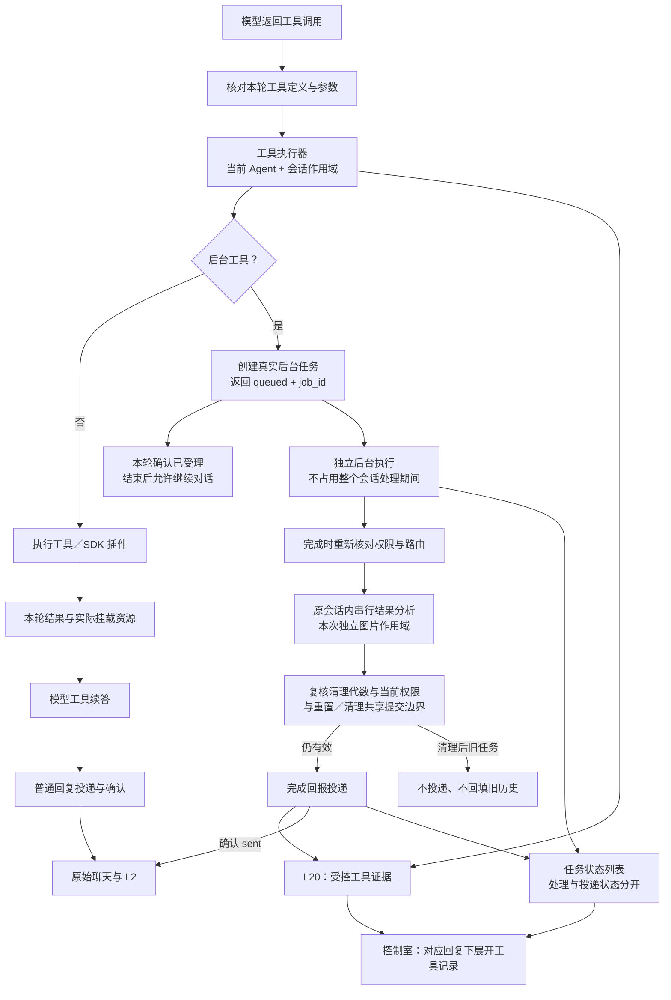
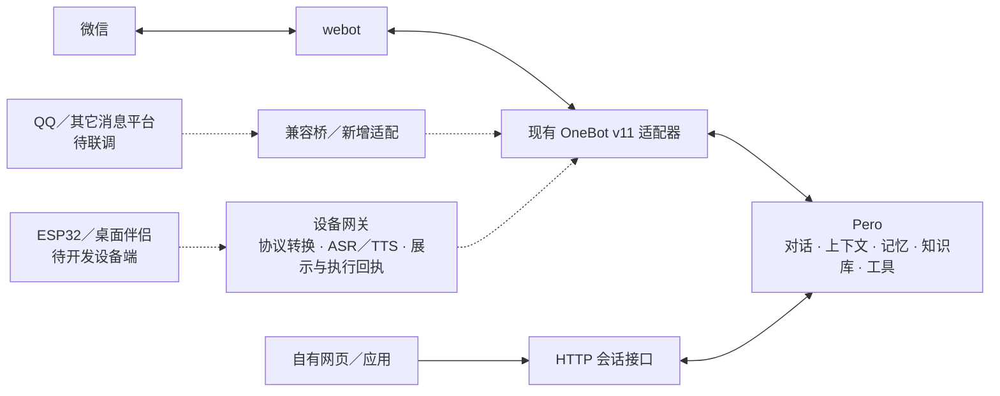

# Pero 工程图

本文按当前代码划分组件职责，配合 README 总图阅读。箭头表示逻辑数据流，不代表每一阶段都会调用模型或把全部数据装入上下文。

## 1. 动态上下文与记忆

- L1、L10 是同一份持久原始聊天的不同读取窗口，不逐级搬运。图中 L1 表示可用的短期窗口，不宣称当前判断机每次都同时输入 L1 和 L10。
- 正式对话默认 L2 以 50 条触发、约 20 条保留，名义归档 30 条；装载正文预算 8,000 字符，并保持完整轮次边界。会话显式配置优先，不以默认值覆盖已有配置。
- L3 只在 L2 成功归档时从本批成员原话派生，不再每句提取；摘要、人物事实、事件和归档标记在同一事务中提交。原始聊天的独立总结与独立事件后台调用默认关闭。
- 系统规则与人格、最新归档前情、稳定 L2 在前，临时检索/旁观参考与当前输入在后；检索由确定性计划按需决定，不增加检索分类模型。资料不提升为 SYSTEM 指令。
- 原始聊天不因归档删除。L4 摘要、人物事实、知识文档与原件具有各自的存储语义。

## 2. 工具与后台任务

后台任务不要求插件另建模型或发送通道。宿主负责结果分析和原会话回报；外部插件保留独立业务实现。缓存命中仍返回真实结果及本轮资源，不跳过完成回报。清理任务列表不删除 L20、聊天、记忆或视频缓存。

长业务在会话锁外运行；完成分析与同会话对话串行，最终复核、发送、L20/L2登记与清理操作互斥。仅确认 sent 的完成文本进入原始聊天和 L2，L20保留原提交轮次/job关联；原轮次已归档时，晚到助手回复作为新交互登记。业务、分析和投递状态分别处理，不为补通知自动重跑插件或模型。

B站插件按视频身份、分P/CID、配置和采样版本复用来源响应与派生拼图。0为自适应、正数指定数量，不设固定帧数上限；不同配置不误用旧拼图。新产物提交遇到已验证的普通写盘异常时补偿恢复旧产物，完整性失败明确判未命中；该策略不等于断电事务。锁等待超时仍可能重复构建。资源始终重新发布到当前会话作用域。

同会话的正式回复与后台完成分析串行，长时间业务执行在会话锁之外。`drain` 拒绝新工作并等待已有任务收尾；真实撤权、插件停用或路由变化仍可阻止回报。

## 3. 消息平台与设备

虚线表示接入方向，不表示已有 QQ 联调结果、ESP32 固件、语音管线或 MQTT 适配器。设备端不需承载完整模型与记忆库；可复用的核心能力运行在电脑或服务器上。具体身份、路由、授权、动作和回执要求见 [接入契约](integration-contract.md)。

## 4. 代码导航

| 区域 | 主要源码 |
| --- | --- |
| 装配与配置 | `src/pero/runtime.py`、`src/pero/core/settings.py` |
| 会话编排与参与策略 | `src/pero/agent/orchestrator.py`、`policy.py`、`private_judge.py` |
| 动态历史与模型循环 | `src/pero/agent/working_history.py`、`loop.py` |
| 模型请求与凭据 | `src/pero/providers/deepseek/`、`src/pero/configuration/credentials.py` |
| 原始聊天、L2 与归档 | `src/pero/memory/chat_stream.py`、`chat_memory.py`、`repository.py` |
| 按需检索计划与业务时间 | `src/pero/agent/retrieval_plan.py`、`src/pero/core/timebase.py` |
| 知识库与本地嵌入接入 | `src/pero/knowledge/` |
| 工具与公共插件契约 | `src/pero/tools/`、`src/pero/plugins/`、`src/pero_plugin_sdk/` |
| 后台任务完成回报 | `src/pero/agent/plugin_jobs.py`、`src/pero/plugins/jobs.py` |
| 消息桥 | `src/pero/channels/onebot11/` |
| 图片、文件和表情资源 | `src/pero/resources/` |
| API、控制室与配置 | `src/pero/api/`、`src/pero/manager/`、`frontend/src/` |
